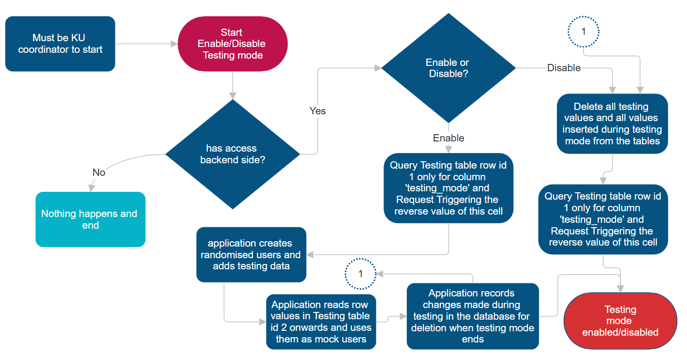
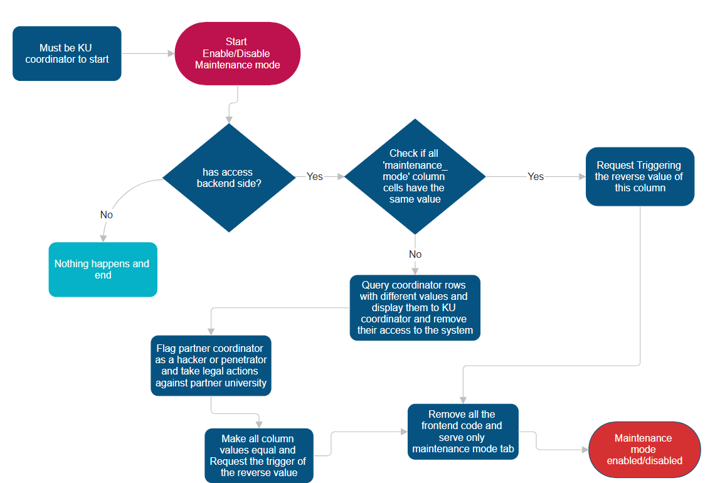
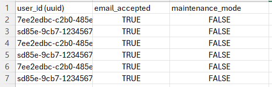

# Instructor Notes: Testing and Maintenance Modes

## Testing mode

Testing mode is controlled by row `id = 1` in `public.testing`. The `enabled` value is readable by the application, but only a KU coordinator can change the mode through the `set_testing_mode` database function. Starting requires maintenance mode to be off.

When testing is enabled, database triggers register each newly inserted application-data row and Storage object in `public.testing`, using foreign keys to the original records. Restrictive row-level security policies allow changes to registered test records while preventing test accounts from changing ordinary application data. Generated test accounts are created through Supabase Auth and have ordinary profile rows, so they exercise the same application flows as other users.

The Testing mode page creates the demo accounts, exchange cycle, partner-coordinator nominations, and submitted applications. Account credentials are stored in the public control row only for these synthetic accounts, allowing visitors to switch roles without entering credentials.

To end testing, the page automatically removes registered uploads through the Supabase Storage API before invoking database cleanup. If Storage reports a deletion error, the page displays the error and keeps testing mode active so cleanup can be retried. After uploads are removed, the database cleanup function deletes registered test rows and generated Auth users, clears the account credentials, and turns testing mode off.

## Maintenance mode

Maintenance status is stored in the `maintenance_mode` field on coordinator rows. The `get_maintenance_mode` function confirms that coordinator values agree; a mismatch is treated as an unavailable status rather than silently choosing one value. Only a KU coordinator can change the status through `set_maintenance_mode`, which checks and updates all coordinator rows together.

When maintenance is active, the application displays a maintenance page to users other than KU coordinators. Restrictive database policies and guarded write functions also block application-data and Storage writes, so the restriction is enforced by the database and not only by the interface. Maintenance mode takes precedence over testing mode: testing cannot be started or ended until maintenance is off.

## Implementation references

- [Schema and database policies](./schema.md)
- [Database schema and functions](../db/schema.sql)
- [Testing mode page](../src/components/TestingMode.jsx)
- [Application routes and maintenance handling](../src/App.jsx)
